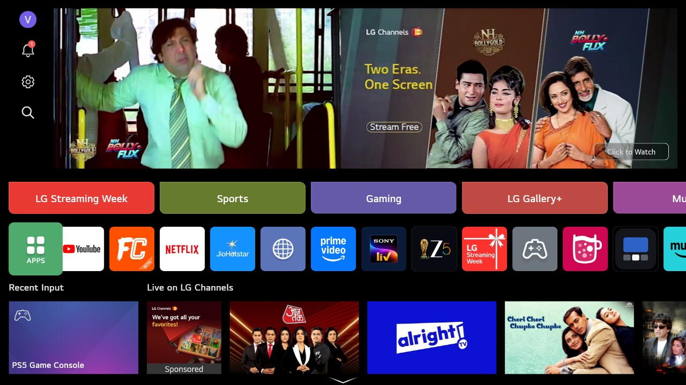
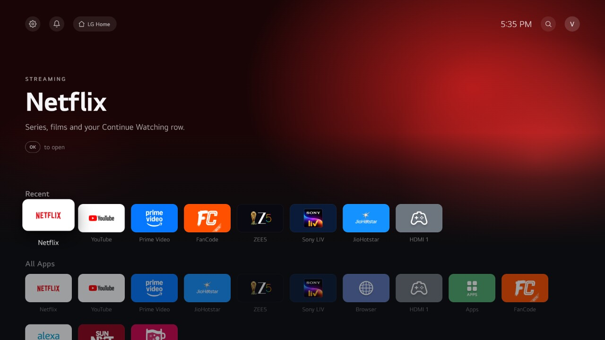

# 📺 OpenTV Launcher for LG

A clean, ad-free home screen for rooted LG webOS TVs, in the style of Apple TV, with a built-in ad blocker.

✅ Tested on an LG OLED42C2PSA (2022) with **webOS 25** (webOS TV 10.3.1, software version 33.31.68), rooted with [slopbro](https://github.com/throwaway96/slopbro).

| 😩 Before: LG's home screen | 😍 After: OpenTV Launcher |
| --- | --- |
|  |  |

---

## ✨ What you get

- 🕘 **Recent row:** your last used apps first (up to 10), topped up with favourites.
- 📱 **All Apps:** every installed app, with its real icon. New apps appear by themselves.
- 🛡️ **Block ads:** one switch removes Prime Video's ad breaks and pause ads, and blocks Google's ad servers for every app (YouTube only partly). Off until you switch it on. Powered by [opentv-adblock-webos](https://github.com/c0d3-ninja/opentv-adblock-webos).
- 👁️ **Hide LG TV apps:** keeps only Browser, Apps (the LG store) and HDMI inputs. Off by default.
- 🗑️ **Delete apps like on LG's home:** hold OK, ⬆️ to **Delete**, confirm in LG's own popup.
- 🔙 **Recent Lists:** press **Back twice** to see open apps, then close one or all.
- 🔄 **Restart button:** clears Recent Lists, then restarts the TV after LG's own confirmation.
- 📊 **Show performance:** memory and storage on the home screen.
- 🏠 **Always your home screen:** at power on, on wake from standby and on **Home**.
- 🛟 **Safe by design:** on any error it tells you and opens LG's home, so the TV is never stuck.
- 🖥️ **Fits any screen,** with smooth animations. No ads, no banners.

---

## 🧪 Compatibility

👨‍💻 It works on my machine.

| webOS version | Will it work? |
| --- | --- |
| webOS 25 (10.x) | ✅ Tested (a 2022 TV upgraded through LG's webOS Re:New) |
| webOS 22 / 23 / 24 (7.x to 9.x) | 🟡 Likely, untested. Same system parts, older web engine. The open question is root for your firmware. |
| webOS 6 | 🟠 Probably, with small fixes |
| webOS 5 and older | 🔴 Not without fixes |

💡 Not sure which webOS you have? In the TV's root shell: `nyx-cmd OSInfo query webos_release` (10.x is webOS 25, 9.x webOS 24, 8.x webOS 23, 7.x webOS 22).

🤖 **Untested version?** Ask an AI assistant to adapt it: share this README, your webOS version and `/tmp/opentvlauncher.log`.

---

## 🧰 Before you start

1. 🔓 **Root your TV.** I used [slopbro](https://github.com/throwaway96/slopbro):
   - 🔎 Your TV not supported by slopbro? Check [CanI.RootMy.TV](https://cani.rootmy.tv) for other options.
   - 🐍 Run slopbro from a computer with Python 3 on the same network, following its README, and accept the pairing prompt on the TV.
   - 🍺 When it finishes, the **Homebrew Channel** is on your TV.
2. 🗑️ **Remove LG's "Developer Mode" app** if you have it. When its session runs out it can delete apps like this one, and the Homebrew Channel already does its job.
3. 🖥️ **Turn on root shell access:** **Homebrew Channel → Settings → Telnet** (or SSH).
4. 🧪 **Log in from a computer on the same network:** `telnet <TV IP address>` (the IP is in **Settings → Network → Advanced Settings**). A `#` prompt means you're root. Mac without telnet? `brew install telnet`.

---

## 🚀 Install

In the TV's root shell, paste:

```sh
curl -fsSL https://raw.githubusercontent.com/c0d3-ninja/opentv-launcher-LG/main/install/install.sh | sh
```

It downloads, installs, sets up the ad blocker (off) and checks every step, ending with **"Done! OpenTV Launcher is installed and verified."** Then press **Home**.

🛟 **TV can't reach GitHub?** On a computer with Python 3, get this repo (`git clone` or **Code → Download ZIP**), run `sh install/serve.sh` inside it, and paste the **INSTALL** line it prints into the TV. Press **Ctrl+C** on the computer when the TV says "Done!".

🔄 **Updating:** run the install command again. Your settings, recent apps and Block ads setting are kept.

---

## 🎮 Using it

| Remote button | What happens |
| --- | --- |
| 🏠 Home | Opens OpenTV Launcher |
| 🆗 OK / hold OK | Open the app / Edit mode: ⬆️ to **Delete**, 🔙 cancels |
| 🔙 Back twice | Recent Lists: ⬆️ to close an app or Close All |
| 🎛️ Sliders (top bar) | Launcher Settings: **Hide LG TV apps**, **Show performance**, **Block ads** |
| 🏠 LG Home (top bar) | LG's original home screen |

🛠️ **Customise** in `app/apps.js` (`dock` favourites, `showLgApps`, `profileInitial`), then `sh build-ipk.sh` and install again.

---

## 🗑️ Uninstall

```sh
curl -fsSL https://raw.githubusercontent.com/c0d3-ninja/opentv-launcher-LG/main/install/uninstall.sh | sh
```

It goes to LG's home first, then removes everything in up to 2 minutes, ending with **"Done! OpenTV Launcher is uninstalled and verified."** The Homebrew Channel and root access are not touched.

- 🛡️ **The built-in ad blocker** is switched off and removed too. A [separately installed](https://github.com/c0d3-ninja/opentv-adblock-webos) one is kept.
- 💡 **Deleted it from LG's home instead?** Within about 2½ minutes the background watcher notices, stops the ad blocker and removes it, deletes its own start-up file and data, and stops. If the TV was off, this happens shortly after the next start.

---

## 🩺 Troubleshooting

- 🔤 **Letters instead of icons:** wait a few seconds and press **Home**.
- 🔒 **"Root access is not on yet":** press **Home** once.
- 🏠 **LG's home instead of the launcher:** run the install command again.
- 🛡️ **No Block ads in Launcher Settings:** run the install command again and check step 7.
- 🛡️ **Ads still show:** `sh /home/root/opentv-adblock/ctl.sh status` and `… ctl.sh logs`, and see the [ad blocker's troubleshooting](https://github.com/c0d3-ninja/opentv-adblock-webos#-troubleshooting).
- 📝 **Anything else:** include `cat /tmp/opentvlauncher.log` when you report it.

---

## 🐢 Good to know

- ⏱️ **At power on,** LG's screen shows first and the launcher takes over after about **3 to 5 seconds**.
- ⚡ **After Home or Back,** the launcher appears within about **0.1 to 1 second**; you may briefly see LG's home. LG doesn't let other apps replace its home screen, so the launcher steps in right after it opens.
- 🛡️ **Switching Block ads** takes a few seconds and closes the apps in Recent Lists, so they open fresh with the new setting.
- 📺 **YouTube ads are only partly blocked.** The Google blocklist stops some of them, but the YouTube app gets most of its ads from YouTube's own servers, the same ones that send the videos, so those can't be blocked without blocking YouTube itself.

---

## 🧩 What's inside

| Path | What it is |
| --- | --- |
| 📁 `app/` | The launcher screen. `boot.js` is the safety net, `apps.js` your favourites, `autostart.sh` the watcher (opens the launcher at power on, on wake and on Home). |
| 🛡️ `app/adblock/` | The built-in ad blocker, a tagged release of [opentv-adblock-webos](https://github.com/c0d3-ninja/opentv-adblock-webos), installed to `/home/root/opentv-adblock`. Update with `sh scripts/sync-adblock.sh ../opentv-adblock-webos <tag>`. |
| ⚙️ `service/` | A small root service: icons, recent apps, closing and deleting apps, memory and storage, settings, the ad blocker switch and restart. It can't run arbitrary commands. |
| 🧰 `install/` | `install.sh` and `uninstall.sh` (run on the TV), `serve.sh` (shares the files from your computer). |
| 📦 `dist/`, 🏗️ `build-ipk.sh` | The ready-to-install IPK, and the script that builds it. |
| 🖼️ `docs/` | Screenshots and the icon's source (SVG). |

📝 The log on the TV is `/tmp/opentvlauncher.log`.

---

## ⚠️ Disclaimer

- 🔓 Rooting your TV **may void its warranty** and can, in rare cases, damage it. **You do this at your own risk.**
- 🤝 An **unofficial, community project**, **not affiliated with, endorsed by or supported by LG Electronics, Apple, Amazon or Google.** "LG", "webOS" and "Apple TV" are trademarks of their owners.
- 🔄 LG software updates may remove root access or stop this launcher from working.
- 🧯 Provided **"as is", without warranty of any kind.** The authors are not responsible for any damage, data loss or other problems.
